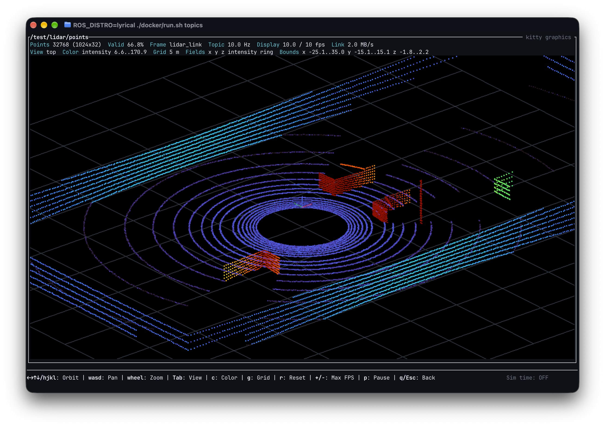
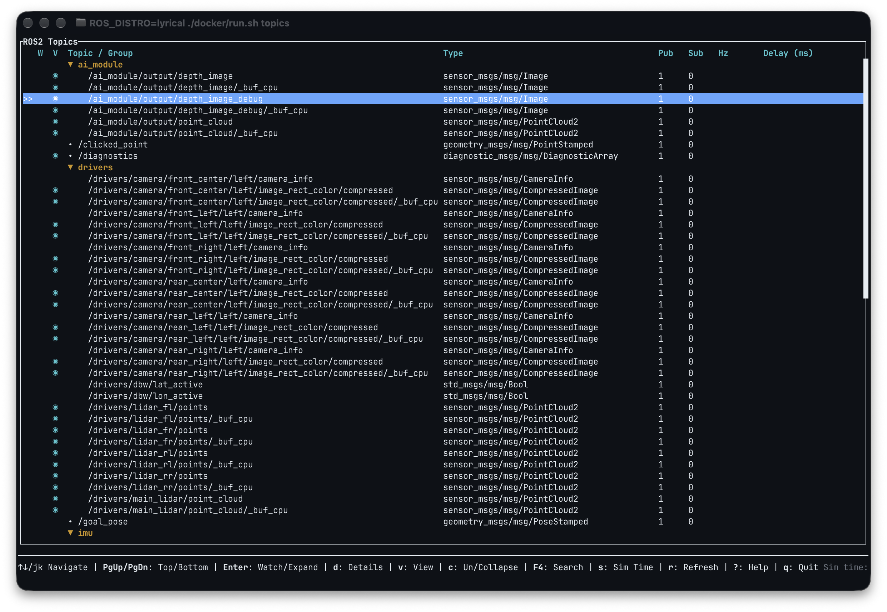
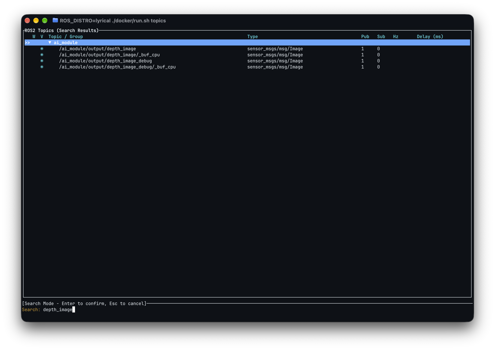
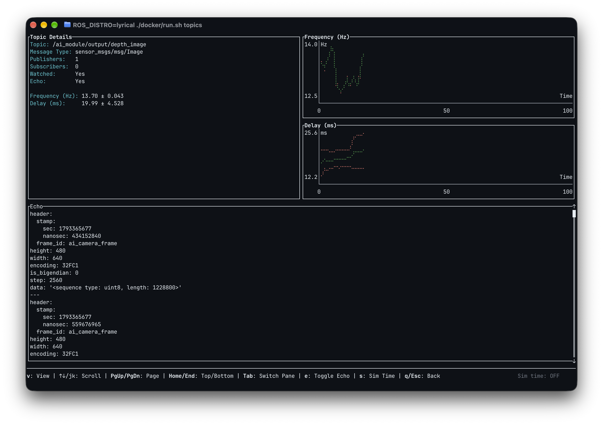
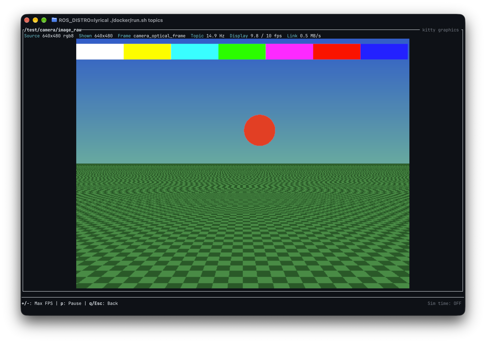
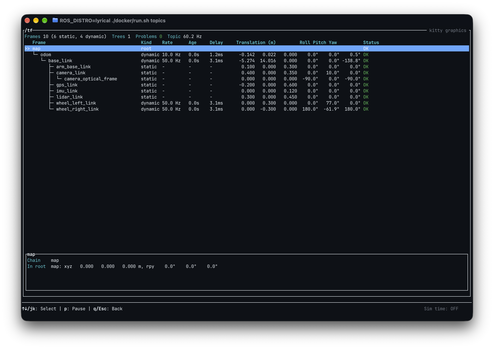
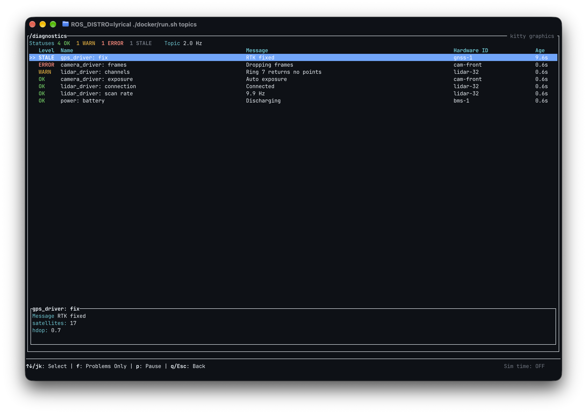
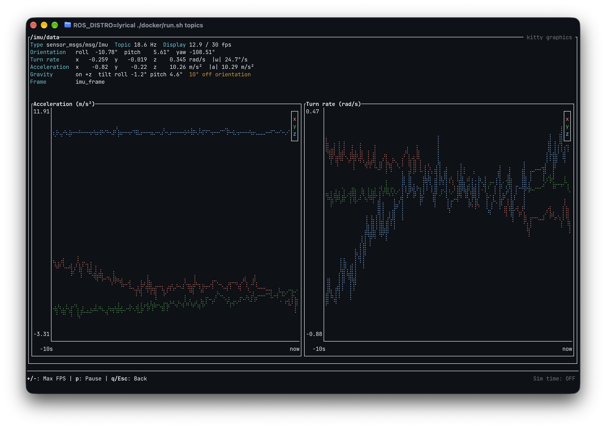
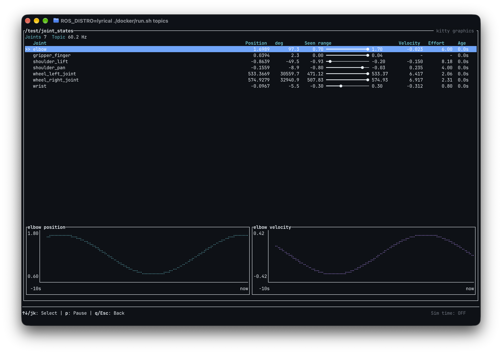

# ros2_tui

[](https://crates.io/crates/ros2_tui)
[](https://pypi.org/project/ros2-tui/)
[](https://docs.ros.org/en/humble/)
[](https://docs.ros.org/en/lyrical/)
[](https://opensource.org/licenses/MIT)
[](https://github.com/TillBeemelmanns/ros2_tui/actions/workflows/test.yml)
[](https://github.com/TillBeemelmanns/ros2_tui/actions/workflows/release.yml)

A powerful Terminal User Interface (TUI) for monitoring and managing ROS2 topics and parameters in real-time, and for looking at sensor data — camera images, point clouds, laser scans, maps, GNSS, IMU and diagnostics — right in the terminal, including over SSH.

## Screenshots

<p align="center"><a href="assets/points.png"></a></p>
<p align="center"><em>A 32-beam lidar in the point cloud viewer, drawn with kitty graphics in Ghostty.</em></p>

<table>
  <tr>
    <td width="33%"><a href="assets/topics.png"></a></td>
    <td width="33%"><a href="assets/search.png"></a></td>
    <td width="33%"><a href="assets/details.png"></a></td>
  </tr>
  <tr>
    <td align="center">Topic tree with publisher/subscriber counts; <code>◉</code> marks topics with a viewer.</td>
    <td align="center">Live search across all topics.</td>
    <td align="center">Topic details with rate and delay charts and a live echo.</td>
  </tr>
  <tr>
    <td width="33%"><a href="assets/image_raw.png"></a></td>
    <td width="33%"><a href="assets/tf.png"></a></td>
    <td width="33%"><a href="assets/diagnostics.png"></a></td>
  </tr>
  <tr>
    <td align="center">Camera image in full resolution.</td>
    <td align="center">TF tree with rates, ages, delays and poses.</td>
    <td align="center">Diagnostics of all drivers, worst first, with stale detection.</td>
  </tr>
  <tr>
    <td width="33%"><a href="assets/imu.png"></a></td>
    <td width="33%"><a href="assets/joint_states.png"></a></td>
    <td width="33%"></td>
  </tr>
  <tr>
    <td align="center">IMU with a gravity check against the orientation and 10 s plots.</td>
    <td align="center">Joint states merged by name, with ranges and plots.</td>
    <td></td>
  </tr>
</table>

## Prerequisites

- ROS2 installed and sourced
- `python3` with `rclpy`, which every ROS2 installation includes: each app does all its ROS access through one embedded `rclpy` helper, and neither runs the `ros2` CLI. No message packages are compiled into the binaries, so one build works on every distribution.

## Terminal

`ros2_tui` is developed and tested with [Ghostty](https://ghostty.org), locally and over SSH. Other terminals work, with these differences:

- **Images, maps and point clouds in full resolution** need the [kitty graphics protocol](https://sw.kovidgoyal.net/kitty/graphics-protocol/). Ghostty supports it; kitty and WezTerm implement it too and should work, but are untested. Elsewhere (iTerm2, Terminal.app, GNOME Terminal, VS Code, and inside tmux or screen) images fall back to colored half blocks and point clouds to braille dots. Set `ROS2_TUI_GRAPHICS=kitty` or `ROS2_TUI_GRAPHICS=halfblocks` to override the detection.
- **24-bit color** for the images and the colored half blocks.
- **A font with box drawing and braille characters** for the tables, trees and plots; any common monospace font has them.
- **A wide window**: around 160 columns shows every table column and the whole key bar. Smaller windows work but cut text off.
- **Mouse wheel** zooms the point cloud viewer; the mouse is captured only while it is open, so text selection works everywhere else.

### Over SSH
- Kitty graphics work over SSH: frames are compressed, capped at 960x720 pixels and scaled up by the terminal, which keeps typical streams at a few MB/s. On slow links, lower a viewer's frame rate with `-`; the info line shows the bandwidth to the terminal.
- With Ghostty, add `shell-integration-features = ssh-env,ssh-terminfo` to its config: the remote side then knows Ghostty's terminal type and that it supports 24-bit color, which plain `ssh` does not pass on.

## Installation

### From pypi

```bash
pip install ros2-tui
```

### From crates.io

```bash
cargo install ros2_tui
```

### From Source

```bash
git clone https://github.com/TillBeemelmanns/ros2_tui.git
cd ros2_tui
cargo build --release
```

The binaries `topics` and `params` will be available at `target/release/`.

### Try it in Docker (no local ROS2 needed)

A self-contained ROS2 environment (Humble by default) with dummy publishers and parameters is provided for quickly trying the TUIs:

```bash
./docker/run.sh topics   # build the image and launch the topics TUI
./docker/run.sh params   # launch the params TUI
./docker/run.sh shell    # drop into a ROS2 shell with the binaries on PATH

ROS_DISTRO=lyrical ./docker/run.sh topics   # use another distro, e.g. Lyrical
```

The container starts the `ros2_tui_test` dummy publishers automatically, so both TUIs come up populated with topics and parameters, and every viewer has realistic data to show:

| Node | Topics |
|---|---|
| `image_publisher` | `/test/camera/image_raw` (rgb8), `/test/camera/image_raw/compressed` (JPEG), `/test/camera/depth` (32FC1) |
| `lidar_publisher` | `/test/lidar/points` (simulated 32-beam lidar with a dead ring), `/test/scan` (270° LaserScan), `/test/points_rgb` (colored cloud) |
| `nav_publisher` | `/test/map` (latched), `/test/costmap`, `/test/gps/fix`, `/test/imu` (100 Hz) |
| `diagnostics_publisher` | `/diagnostics` from several simulated drivers, one of which keeps going stale |
| `robot_publisher` | `/tf` and `/tf_static` of a robot driving a circle (a wheel frame goes stale and `base_link` gets a second parent now and then), `/test/odom`, `/test/plan`, `/test/joint_states`, `/test/battery` |
| `dummy_publisher` | `/test/sine_wave` and other jittery topics for the Hz/delay charts |
| `multi_publisher` | Many automotive-style topics with varying rates for the Hz/delay monitoring |

## Topics TUI (`topics`)

### Highlights
- 📊 Real-time Hz/Delay monitoring of watched topics, measured by one lightweight helper process for all topics
- 🌳 Namespace-aware topic tree with collapsible groups and instant search
- 🎯 Watch-only metrics so large graphs stay responsive and low overhead
- 🎨 Status indicators, Bollinger-band charts, and debug logging for on-call triage
- 🖼️ Live image viewer for `sensor_msgs/Image` and `CompressedImage` topics, in full resolution on terminals with the kitty graphics protocol (Ghostty, kitty, WezTerm), even over SSH
- 🛰️ Point cloud and laser scan viewer for `sensor_msgs/PointCloud2` and `LaserScan`: top-down, orbiting 3D and side views with statistics
- 🗺️ Map viewer for `nav_msgs/OccupancyGrid` maps and costmaps, including latched maps
- 📡 GNSS viewer for `sensor_msgs/NavSatFix` (fix status, accuracy, track) and IMU viewer for `sensor_msgs/Imu` (orientation, gravity check, live plots)
- 🩺 Diagnostics viewer for `diagnostic_msgs/DiagnosticArray` (`/diagnostics`): every driver's status in one table, worst first, with stale detection
- 🌳 TF tree viewer for `/tf` and `/tf_static`: every frame with rate, age and delay, and the problems that break transforms: stale frames, frames with two parents, cycles and disconnected trees
- 🚗 Odometry, path, joint state and battery viewers: trail with jump detection, planned paths, joint tables with plots, charge with cell balance

### Usage
```bash
# Start monitoring with default settings
topics

# Custom refresh rate (topics list updates every 5 seconds by default)
topics --refresh 10
```

Toggling a row with `Enter` starts Hz/Delay measurement. Unwatched topics stay lightweight, ensuring responsive navigation even with hundreds of topics.

### Navigation & Controls
- `↑`/`↓` or `j`/`k` move between topics, `PgUp`/`PgDn` jump to the first/last; `←`/`→` or `h`/`l` collapse and expand namespaces
- `Enter` toggles watching on the focused topic or expands/collapses a group
- `d` opens the detail view, where `Tab` switches between the info and echo panes; `c` collapses/expands all groups at once
- `s` toggles simulation time when measuring delay metrics
- `v` opens the viewer on a topic marked `◉` in the `V` column (images, maps, point clouds, laser scans, GNSS, IMU, diagnostics, TF, odometry, paths, joint states, batteries), from the list or the detail view; `+`/`-` change the frame rate limit (1–30 fps, default 10), `p` pauses, `q`/`Esc` go back
- `F4` opens live search with auto-expansion; `Space`, `r`, or `F5` refresh immediately
- `q`, `Esc`, or `Ctrl+C` quit; `--verbose` writes detailed logs to `topics_debug.log`

### Command-Line Options
- `--refresh <SECONDS>` – Topic list refresh cadence (default: 5)
- `--detail-refresh <SECONDS>` – Legacy detail polling interval (still accepted)
- `--no-initial-fetch` – Skip the initial topic list fetch
- `--help`, `--version` – Standard metadata flags

### Viewers at a Glance

Press `v` on a topic marked `◉` to see its data. Common keys in every viewer: `+`/`-` change the frame rate limit, `p` pauses, `q`/`Esc` go back.

| Message type | Viewer | Shows |
|---|---|---|
| `sensor_msgs/Image`, `CompressedImage` | Image | The camera image; depth with a colormap |
| `nav_msgs/OccupancyGrid` | Map | Map or costmap, north up, with resolution, size and coverage |
| `sensor_msgs/PointCloud2` | Point cloud | Top, orbit and side views, colored by rgb, intensity, height or distance |
| `sensor_msgs/LaserScan` | Point cloud | The scan plane with angle span, range limits and measured ranges |
| `sensor_msgs/NavSatFix` | GNSS | Fix status, satellites, position, accuracy and a track |
| `sensor_msgs/Imu` | IMU | Orientation, turn rate, acceleration, a gravity check and plots |
| `diagnostic_msgs/DiagnosticArray` | Diagnostics | Every driver's status, worst first, with stale detection |
| `tf2_msgs/TFMessage` (`/tf`, `/tf_static`) | TF tree | Frames as a tree with rate, age, delay and pose; stale frames, two parents, cycles |
| `nav_msgs/Odometry` | Odometry | Pose, speed, distance, jumps, covariance, a trail and velocity plots |
| `nav_msgs/Path` | Path | The path with start and end, length and pose count |
| `sensor_msgs/JointState` | Joint states | Position, velocity and effort of every joint, the range seen, plots of the selected joint |
| `sensor_msgs/BatteryState` | Battery | Charge, time left, voltage, current, health, cell balance and plots |

### Image Viewer
- Supported encodings: `rgb8`, `bgr8`, `rgba8`, `bgra8`, `mono8`, `mono16`, 16-bit color, `yuv422`/`uyvy`, `yuv422_yuy2`/`yuyv`, `bayer_*8`, and depth (`16UC1`, `32FC1`) shown with a turbo colormap. Compressed images: JPEG, PNG and `compressedDepth`.
- The info line shows the source size and encoding, the topic rate, the displayed frame rate and, with kitty graphics, the bandwidth to the terminal.
- Images use the kitty graphics protocol when the terminal answers its query and fall back to colored half blocks otherwise; see [Terminal](#terminal).

### Point Cloud Viewer
- Three views, cycled with `Tab`: **top** (orthographic bird's eye view, x up), **orbit** (perspective from behind the sensor) and **side**. The camera starts fitted to the cloud.
- `←→↑↓`/`hjkl` orbit, `wasd` pan, the mouse wheel zooms, `r` resets the camera, `g` toggles the ground grid.
- `c` cycles the coloring: `rgb` (packed `rgb`/`rgba` fields), intensity (`intensity`, `reflectivity` or `i`), height and distance. Value ranges span the 2nd to 98th percentile so outliers do not wash out the colors.
- Two info lines show the point count and layout, the share of valid points, the frame, the fields, the bounding box, the color range and the grid spacing.
- Points are shown in the cloud's own frame. Clouds over 200,000 points are sampled evenly for display; the counts refer to the whole cloud.
- Without kitty graphics, clouds are drawn with braille dots (2x4 per cell).
- `LaserScan` topics open in the same viewer: returns become points in the scan plane, colored by intensity or distance, and the info lines show the angle span and step, the range limits and the measured ranges. Ranges outside the limits count as invalid.

### Map Viewer
- `OccupancyGrid` topics (maps and costmaps) open in the image viewer with north up: free cells white, occupied black, unknown slate.
- A second info line shows the resolution, the size in meters, the origin and the share of known, occupied and free cells.
- Latched maps (transient local) are received even when they were published before the viewer opened.

### GNSS Viewer
- `NavSatFix` topics show the fix status, the satellite systems in use, latitude, longitude, altitude and the accuracy from the covariance.
- A track of the recent fixes, in meters with north up, marks the latest position and its horizontal accuracy.

### IMU Viewer
- `Imu` topics show orientation as roll, pitch and yaw, the turn rate and the acceleration; fields marked as not provided (covariance -1) say so.
- A gravity check names the axis gravity is measured on and the tilt it implies, and says whether that matches the reported orientation, which catches wrong mounting or frame conventions.
- Plots show the acceleration and turn rate of the last 10 seconds. The default frame rate limit is 30 fps for IMUs.

### Diagnostics Viewer
- Statuses from all partial `DiagnosticArray`s are merged by name into one table, sorted worst first (STALE, ERROR, WARN, OK), with the hardware ID and time since the last update.
- A status not updated for 5 seconds turns STALE, which catches drivers that died without saying so.
- `↑`/`↓` or `j`/`k` select a status and show its key/value pairs below the table; `f` shows only problems.
- Diagnostics are never rate limited, so no driver's array is dropped.

### TF Tree Viewer
- Opening `/tf` or `/tf_static` subscribes to both and shows every frame as a tree from its root, with static or dynamic, update rate, time since the last update, stamp delay, and the transform to its parent.
- Problems are marked per frame: a dynamic frame without an update for 5 of its periods (at least 1 s) is stale; a frame published with two parents means two broadcasters disagree; frames that are their own ancestor are in a cycle. The info line counts frames, trees (more than one means a missing link) and problems.
- `↑`/`↓` or `j`/`k` select a frame: below the tree are its chain to the root and its pose in the root frame.
- TF is never rate limited, so no broadcaster's transforms are dropped.

### Odometry and Path Viewers
- `Odometry` topics show the frames, position, heading, speed, turn rate, the distance travelled and the pose standard deviations, beside a trail with the current heading. A step longer than the reported speed explains counts as a jump, e.g. a reset. Plots show the linear and angular velocity of the last 10 seconds.
- `Path` topics draw the path in its frame, start green and end red, with its length and pose count.

### Joint State Viewer
- Joints from all `JointState` messages are merged by name, as arm and gripper often publish separately: position (rad and degrees), velocity, effort and age, and a bar showing where the position lies in the range seen so far.
- Stale joints are grayed out, NaN values highlighted, and messages whose arrays do not match their names reported.
- `↑`/`↓` or `j`/`k` select a joint to plot its position and velocity.
- Joint states are never rate limited, so no source's partial message is dropped.

### Battery Viewer
- `BatteryState` topics show the charge with time left at the present current, voltage, current and power, capacity, temperature, health, technology and location; values the battery does not measure (NaN) say so.
- Cell voltages are shown as bars with their spread; the weakest cell is highlighted when the spread exceeds 50 mV.
- Plots show voltage and current of the last 10 minutes.

## Params TUI (`params`)

### Highlights
- 🧭 Node/namespace browser that mirrors `ros2 param list` hierarchies
- 🔄 Live value polling keeps displayed values fresh without manual refreshes, with all nodes queried at once by one helper process
- ✏️ In-terminal editing that keeps each parameter's type, plus YAML dump/load workflows
- 🧰 Built-in search, success/error banners, and contextual help overlays

### Usage
```bash
# Parameter dashboard with 5 second refresh
params

# Faster poll rate for parameters
params --refresh 2
```

The app groups dotted parameter names into expandable namespaces so large graphs stay navigable. Value edits, dumps, and loads go through the parameter services of the nodes and report their outcome inline.

### Navigation & Controls
- `↑`/`↓` or `j`/`k` move through nodes and parameters, `PgUp`/`PgDn` jump to the first/last; `←`/`→` or `h`/`l` collapse/expand namespaces
- `?` opens the help overlay; `F4` enters search mode with persistent filtering
- `Space`, `r`, or `F5` refresh on demand; `Esc` exits dialogs, cancels search, or quits

### Parameter Actions
- `s` edits the selected parameter. The value is read as YAML like `ros2 param set` does (`[1, 2]` is an array, `true` a boolean), but keeps the parameter's type where it can: `80` sets a double parameter to `80.0`, and any text sets a string parameter.
- `d` dumps the current node to YAML, in the format of `ros2 param dump`
- `Ctrl+l` loads such a YAML file into the active node, like `ros2 param load`; parameters that already have the file's value are skipped, so a dump loads back even with read-only parameters in it
- Inline success/error banners acknowledge operations and fade automatically

### Command-Line Options
- `--refresh <SECONDS>` – Parameter polling cadence (default: 5)
- `--no-initial-fetch` – Skip the initial parameter scan
- `--verbose` / `-v` – Emit detailed logs to `params_debug.log`
- `--help`, `--version` – Standard metadata flags

## Development

### Building

```bash
cargo build --release
```

### Testing

```bash
cargo test
cargo check
```


### Before Pushing
Check formatting
```bash
cargo fmt --all -- --check
```

Lint code
```bash
cargo clippy --all-targets --all-features -- -D warnings
```

### Release Safety Check

Configure Git once so the bundled pre-push hook runs before release pushes:

```bash
git config core.hooksPath .githooks
```

When you push a tag such as `v0.3.0`, the hook calls `scripts/check-release-version.sh` and verifies the tag matches the `Cargo.toml` version. The push is rejected if they diverge, keeping release tags in sync with the crate metadata.


## Contributing

Contributions are welcome! Please feel free to submit a Pull Request.

## License

This project is licensed under the MIT License - see the [LICENSE](LICENSE) file for details.

## Acknowledgments

- Inspired by [turm](https://github.com/kabouzeid/turm) - A TUI for the Slurm Workload Manager
- Built with [ratatui](https://github.com/ratatui-org/ratatui) - A Rust library for building rich terminal interfaces

## Roadmap

Planned features, improvements, and fixes are tracked in [ROADMAP.md](ROADMAP.md).
